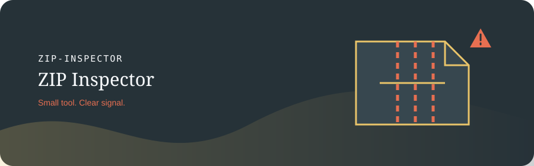

<div align="center">



# ZIP Inspector

**A read-only ZIP audit tool for safer archive handling.**

[](https://www.python.org/) [](LICENSE)

</div>

## Why it exists

Inspect an archive before extraction and spot suspicious paths or compression ratios. Lists archive members and flags absolute paths, parent-directory traversal, unusually high compression ratios and oversized entries. It never extracts files and cannot determine whether an archive's contents are trustworthy.

## Features

- Path traversal and absolute-path checks
- Compression-ratio and uncompressed-size warnings
- Member summary without extraction
- JSON report for automation

## Quick start

Python 3.10+; no third-party packages.

```bash
git clone https://github.com/MofidChallenge10/zip-inspector.git
cd zip-inspector
python tool.py --help
```

### Example

```bash
python tool.py downloads/package.zip
```

## Self-test

```bash
python tool.py --self-test
```

The self-test uses the standard-library `unittest` module. Network-based tools do not contact external services during self-test.

## Scope and safety

Lists archive members and flags absolute paths, parent-directory traversal, unusually high compression ratios and oversized entries. It never extracts files and cannot determine whether an archive's contents are trustworthy. Review output before using it in production workflows.

## Design notes

The illustration is an original lightweight SVG. Motion is decorative and stops when `prefers-reduced-motion` is enabled; CLI output remains plain and pipe-friendly.

## Contributing

Issues and pull requests are welcome. Keep dependencies minimal, add focused tests for behavior changes, and update examples when options change.

## License

MIT — see [LICENSE](LICENSE).
